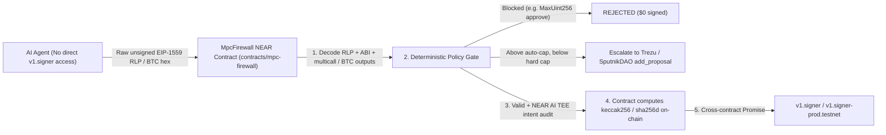

# MpcFirewall

**Zero-blind-signing RLP, EVM ABI calldata, nested `multicall`, and Bitcoin raw-transaction firewall for NEAR Chain Signatures (`v1.signer`).**

- **Live Web Console:** [https://mpc-firewall.netlify.app](https://mpc-firewall.netlify.app)
- **Live NEAR Testnet Contract:** [`mpc-firewall.testnet`](https://testnet.nearblocks.io/address/mpc-firewall.testnet) (Deploy + Init TX: [`3B94S9sB92jABvy2rYt4sZXiD4Rri47v3RpULScY3XQs`](https://testnet.nearblocks.io/txns/3B94S9sB92jABvy2rYt4sZXiD4Rri47v3RpULScY3XQs), Live `verify_and_sign_evm -> v1.signer-prod.testnet` Secp256k1 Signature TX: [`9CMZemnkejMCCJHeUXHBtHp4A49T71aLyjoBBQ98ZxVN`](https://testnet.nearblocks.io/txns/9CMZemnkejMCCJHeUXHBtHp4A49T71aLyjoBBQ98ZxVN))
- **License:** [MIT](./LICENSE)

---

## 1. What Problem It Solves (Not Already Solved on NEAR)

Existing NEAR agent-security projects (such as Function Call Key wrappers, spend-cap vaults, and NEAR-native policy firewalls) enforce constraints on **NEAR-native calls** (`receiver_id`, `method_names`, `allowance`).

They **cannot** protect assets on **Ethereum, Base, Arbitrum, or Bitcoin** controlled via **NEAR Chain Signatures (`v1.signer` / `v1.signer-prod.testnet`)**:
1. `v1.signer.sign` only receives an opaque **32-byte digest** (`payload: [u8; 32]`, `path: String`, `key_version: u32`).
2. Neither NEAR validators nor Function Call Keys can decode what a 32-byte `keccak256` hash signs.
3. A compromised or prompt-injected AI agent with a scoped Function Call Key can hash `ERC20.approve(attacker, MaxUint256)` or a hidden `multicall` drain, call `v1.signer.sign`, and drain 100% of the derived foreign-chain wallet.

---

## 2. How MpcFirewall Works



1. **Contract-Owned MPC Derivation Path:** Chain Signatures derives foreign-chain addresses from `(predecessor_account_id, path)`. By binding the treasury wallet to `mpc-firewall.testnet`, agents never hold direct signing authority on `v1.signer`.
2. **On-Chain RLP & Calldata Decoder (`contracts/mpc-firewall/src/lib.rs`):** Accepts raw unsigned EVM (`0x02` EIP-1559 or Legacy RLP) or Bitcoin transactions, decodes `chain_id`, `to`, `value_wei`, 4-byte ABI selectors (`transfer`, `approve`, `transferFrom`, `setApprovalForAll`), recursively unwraps `multicall(bytes[])` / `multicall(uint256,bytes[])` up to depth 3, and parses Bitcoin `vout` scriptPubKeys + satoshi outputs before computing `env::keccak256` / `env::sha256` on-chain.
3. **Confidential Intent vs. Calldata Co-Audit (`NEAR AI Cloud`):** Uses `@nearai/inference-sdk/node` against `https://cloud-api.near.ai/v1/` (with transparent fallback to an Ed25519-signed local verifiable enclave when `NEARAI_API_KEY` is unset) so agent strategy prompts remain private inside TEE.
4. **Governance & Cross-Chain Liquidity (`Trezu / SputnikDAO` & `NEAR Intents`):** Valid transactions exceeding autonomous limits generate `add_proposal` payloads for Trezu / SputnikDAO; the console also integrates `https://1click.chaindefuser.com/v0/tokens` and `POST /v0/quote` (including `confidentiality: "advanced"` Confidential Intents previews) plus read-only NEAR RPC probes against `v1.signer-prod.testnet`.

---

## 3. Hackathon Tracks & NEAR Features Used

| Track ID | NEAR Features & Implemented Capabilities |
| :--- | :--- |
| `security` | Contract-owned MPC path, deterministic RLP/ABI/BTC firewall, Function Call Key blind-signing mitigation, nested `multicall` unwrapping, daily native/token/satoshi spend caps, and NEAR AI TEE verification. |
| `agents` | Safe cross-chain agent execution on Base/Arbitrum/Bitcoin without handing over unconstrained `v1.signer` signing authority. |
| `privacy` | **NEAR AI Cloud** (`@nearai/inference-sdk`) private intent-vs-calldata audit (with honest `local-verifiable-enclave` semantic fallback when `NEARAI_API_KEY` is unset) + **NEAR Intents** 1Click quote integration (`confidentiality` mode & live mainnet dry quotes). |

*Additional ecosystem integrations implemented in the workflow:* **Trezu / SputnikDAO** `add_proposal` escalation payloads for transactions exceeding autonomous limits, and live NEAR Testnet RPC inspection (`v1.signer-prod.testnet`).

---

## 4. Try It — Deterministic "Do X -> See Y" Verification Steps

### Prerequisites
- Node.js `>= 20` (tested on `v22.17.0`)
- `pnpm` (`10.x`)
- Zero API keys or mainnet funds required (all cryptographic decoders, policy gates, and Ed25519 enclave verification run locally; optional live keys go in `.env`).

### Step A: Install, Typecheck, Test, and Build
1. **Do:**
   ```bash
   pnpm install
   pnpm typecheck
   pnpm test
   pnpm build
   ```
   **See:** All TypeScript packages (`@mpc-firewall/core`, `@mpc-firewall/web`) compile cleanly and all 28 tests across 5 suites pass (`btcDecoder.test.ts`, `evmDecoder.test.ts`, `firewallEngine.test.ts`, `firewallService.test.ts`, `hardening.test.ts`).

### Step B: Run Deterministic CLI Judge Suite & HTTP E2E Suite
2. **Do:**
   ```bash
   pnpm verify:judge
   pnpm test:e2e
   ```
   **See:** JSON receipts for 7 real byte-encoded EIP-1559 & Bitcoin transactions:
   - `safe-base-usdc` -> `outcome: "APPROVED_FOR_MPC_SIGN"`, `mpcDispatchGenerated: true`, `teeSignatureVerified: true`
   - `attack-unlimited-approve` -> `outcome: "BLOCKED"`, codes `["ERR_BLOCKED_ADDRESS", "ERR_UNLIMITED_APPROVAL", "ERR_DAILY_TOKEN_CAP_EXCEEDED"]`, `mpcDispatchGenerated: false`
   - `attack-nested-multicall` -> `outcome: "BLOCKED"`, codes `["ERR_UNLIMITED_APPROVAL", "ERR_NESTED_MULTICALL_VIOLATION", "ERR_DAILY_TOKEN_CAP_EXCEEDED"]`
   - `attack-wrong-chain` -> `outcome: "BLOCKED"`, codes `["ERR_CHAIN_ID_NOT_ALLOWED"]`
   - `attack-nft-approval` -> `outcome: "BLOCKED"`, codes `["ERR_SET_APPROVAL_FOR_ALL_BLOCKED"]`
   - `escalate-dao-250usdc` -> `outcome: "ESCALATE_TO_DAO"`, `daoProposalGenerated: true`
   - `attack-btc-hijack` -> `outcome: "BLOCKED"`, codes `["ERR_BTC_OUTPUT_EXCEEDS_CAP", "ERR_BTC_UNAPPROVED_OUTPUT_SCRIPT"]`

### Step C: Launch Web Security Console & Inspect Live Flows
3. **Do:**
   ```bash
   pnpm start
   ```
   Open `http://localhost:3000`.
   **See:** Three-column Security Console (On-Chain Policy Gate, Unsigned Transaction & Attack Simulator, Proof & Dispatch Inspector).
4. **Do:** Click scenario **2. Blind-Sign Attack: ERC-20 approve(drainer, MaxUint256)** and click **Decode, Audit & Verify Before v1.signer**.
   **See:** Crimson `BLOCKED` banner showing the exact opaque 32-byte `keccak256` digest vs. decoded `0x095ea7b3` selector, `ERR_UNLIMITED_APPROVAL`, and zero dispatch payload.
5. **Do:** Click scenario **3. Smuggled Drain: Nested multicall(bytes[]) Hidden Approve** and click **Decode, Audit & Verify Before v1.signer**.
   **See:** Recursive call tree displaying `depth=0 MULTICALL` -> `depth=1 ERC20_TRANSFER` and `depth=1 ERC20_APPROVE (MaxUint256)`, blocked with `ERR_NESTED_MULTICALL_VIOLATION`.
6. **Do:** Click scenario **1. Compliant Base USDC Vendor Payout (25 USDC)** and click **Decode, Audit & Verify Before v1.signer**.
   **See:** Emerald `APPROVED_FOR_MPC_SIGN` banner, verified TEE signature badge, and exact `verify_and_sign_evm -> v1.signer-prod.testnet` payload.
7. **Do:** Click **Probe v1.signer-prod.testnet** (top bar) or **Preview Confidential Intents Treasury Refuel Quote** (right panel) when online.
   **See:** Live NEAR Testnet RPC `public_key` query result or live NEAR Intents 1Click API preview (`confidentiality: "advanced"`).

---

## 5. Production Hardening Mode

When deploying beyond local evaluation, set these flags in `.env`:
- `MPC_FIREWALL_ADMIN_TOKEN=<random-secret>` + `REQUIRE_ADMIN_AUTH=true`: Enforces constant-time Bearer / `x-admin-token` auth on `PATCH`/`POST /api/policy` (`401`/`503` otherwise).
- `STRICT_LIVE_TEE=true` + `NEARAI_API_KEY=<key>`: Disables local enclave fallback and fails closed (`ERR_TEE_UNAVAILABLE`) if live NEAR AI Cloud TEE attestation is unavailable.
- Concurrent requests to `FirewallService` serialize via an internal async mutex and persist atomically (`temp-file` + `renameSync`), tracking `processedDigests` (replay protection), `dailyTokenSpentUnits`, and `dailyNativeSpentWei`.

---

## 6. Repository Structure & Disclosures (`Q-005`)

- `contracts/mpc-firewall/src/lib.rs` — Rust NEAR smart contract (`near-sdk = "=5.12.0"`) with on-chain RLP, ABI, `multicall`, Gnosis Safe `execTransaction`, Uniswap `Permit2` & `UniversalRouter`, and Bitcoin output/daily-satoshi/BIP-143 SegWit (`verify_and_sign_btc_bip143`) decoders + 17 unit tests (latest Testnet WASM at [`mpc-firewall.testnet`](https://testnet.nearblocks.io/address/mpc-firewall.testnet), `code_hash`: `GZUSiL4fFkM3RwByaYKFFFGVNRWwKtX6uHbkscqSJVkS` from CI run [`43400092688`](https://github.com/pipedrimer/mpc-firewall/actions/runs/43400092688), verified rejecting `MaxUint256` approve with `ERR_BLOCKED_ADDRESS: recipient blocked` and completing a live cross-contract `verify_and_sign_evm -> v1.signer-prod.testnet` Secp256k1 signature in TX [`9CMZemnkejMCCJHeUXHBtHp4A49T71aLyjoBBQ98ZxVN`](https://testnet.nearblocks.io/txns/9CMZemnkejMCCJHeUXHBtHp4A49T71aLyjoBBQ98ZxVN)).
- `packages/core/` — Shared TypeScript decoders, policy engine, NEAR AI Cloud (`@nearai/inference-sdk/node`), NEAR Intents 1Click, NEAR RPC, OutLayer/DAO payload builders, and 5 test suites (28 tests).
- `apps/web/` — Next.js App Router API routes & interactive Security Operations Console (uses `ethers` for EIP-1559/ABI encoding, `lucide-react`, and `@nearai/inference-sdk`).
- `.github/workflows/ci.yml` — Automated Ubuntu CI running `pnpm typecheck`, `pnpm test`, `pnpm build`, `pnpm verify:judge`, `pnpm test:e2e`, `cargo test --locked`, and `cargo build --target wasm32-unknown-unknown --release`.
- `scripts/judge-demo.mjs` — CLI verification script.
- `scripts/validate-submission.mjs` — Validates `submission-payload.json` against `HACKATHON.md`.
- `SUBMISSION_CHECKLIST.md`, `submission-template.json`, `X_DEMO_POST_DRAFT.md` — Human-reviewed submission packaging.
- **Libraries & AI Tooling Disclosure:** Built from scratch during this hackathon using `near-sdk`, `ethers`, `next`, `zod`, `@nearai/inference-sdk`, and AI coding assistance (for scaffolding, test generation, interactive 3D/SVG story UI components, and security audit hardening).
